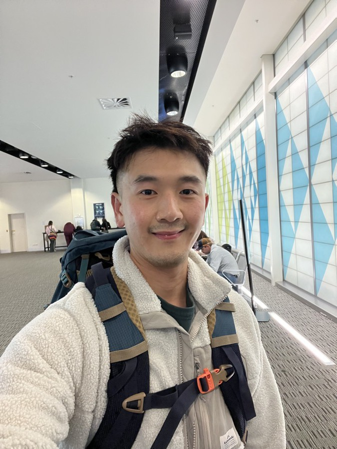

# My portfolio website: how it works

Built with **Quarto**. You write pages as `.qmd` text files; Quarto turns them
into a website in the `_site/` folder. Live address (once published):
**https://yokytreera.github.io**

## Everyday use

1. Double-click `website.Rproj` to open the project in **RStudio**.
2. In RStudio's **Terminal** tab (bottom panel), run: `quarto preview`
   The site opens in your browser and refreshes every time you save a file.
3. Edit a `.qmd` file → save → look at the browser.
4. Stop the preview with **Ctrl + C** in the Terminal.
5. When you are happy, publish the changes (see "Publishing" below).

## Where everything lives

| File / folder | What it is | How to update |
|---|---|---|
| `_quarto.yml` | Site title, menu bar, footer, theme | Menu: copy/delete a `- href:` + `text:` pair |
| `index.qmd` | Home page (photo, tagline, 3 cards) | Edit the text between `:::` lines |
| `about.qmd` | About page (bio, education, experience…) | Edit text; dates go in `[2024]{.yr}` |
| `th/about.qmd` | **The only Thai page** (Thai About) | Keep it roughly in step with `about.qmd` |
| `projects/` | One sub-folder per project | See "Adding a project" |
| `publications.qmd` | Publications list | Copy a numbered line and edit it |
| `blog/` | One sub-folder per post | Copy `blog/welcome/` and edit it |
| `files/Yoky-Treerasoradaj-CV.pdf` | The CV people download | Replace the file, **keep the same name** |
| `images/` | Photo, SDG icons, card picture | Replace files, keep the names |
| `styles/light.scss`, `dark.scss` | Colours (Sierra Blue palette) | Change the `#hex` values |
| `styles/common.scss` | Shared layout and design | Ask Claude before big changes |
| `js/hero-bg.js` | Picks the photo background (`rising` or `waves`) and shows the compare switch | Set `DEFAULT`; set `SHOW_COMPARE_SWITCH = false` before publishing |
| `js/rising-lines.js` | Rising lines behind the photo | Change look in `DEFAULTS` at the top |
| `js/sliced-waves.js` | Light waves behind the photo (React Bits port) | Change look in `OPTIONS` at the top |
| `_includes/head.html` | Loads the Thai font | Leave as is |
| `_includes/after.html` | EN / ไทย button script | Leave as is |
| `_site/` | The finished website Quarto builds | **Never edit; it is overwritten** |
| `.quarto/`, `_freeze/` | Quarto's working folders | Ignore |

## Small formatting codes used in this site

    [2024]{.yr}                  a date pushed to the right of a line
    [Some skill]{.chip}          a rounded skill tag (inside ::: {.chips})
    [Text]{.placeholder-note}    grey italic "to do" note; delete when filled
    [Link text](page.qmd){.btn-pill}   a blue pill button
    <!-- note -->                hidden comment: not shown on the website

## Adding a project

1. Copy any folder in `projects/` and rename it (lowercase, dashes: `flu-forecast`).
2. In its `index.qmd`, edit `title`, `description`, `date`, `categories` at the top.
   `date` decides the order of the cards (newest first).
3. Optional picture: put `cover.jpg` in that folder and add `image: cover.jpg`
   to the top block. Without it, the card gets the Sierra Blue picture.
4. Optional R code: add a chunk like this and Quarto runs it when building.

        ```{r}
        library(fpp3)
        autoplot(aus_production, Beer)
        ```

## Updating the CV PDF

Rebuild your CV with `build_cv_e-t.py`, open the HTML in Chrome, then
Print → Save as PDF (A4, margins None, Background graphics ON).
**Remove the phone number first** (or ask Claude to). Save it over
`files/Yoky-Treerasoradaj-CV.pdf`.

## Publishing (after the first setup)

In the RStudio Terminal: `quarto publish gh-pages`
This builds the site and uploads it. It is live about 1 minute later.

## Markdown cheatsheet

    ## Section heading          **bold**        *italic*
    - bullet point              [link text](https://...)
    1. numbered item            
