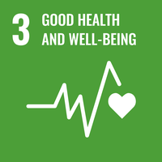
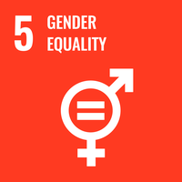
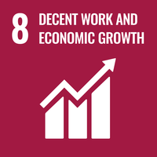
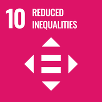
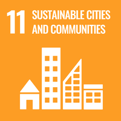
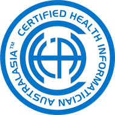

::: {.profile-links}
[Download CV (PDF)](files/Yoky-Treerasoradaj-CV.pdf){.primary}
[LinkedIn](https://www.linkedin.com/in/tnutachat/)
[Email](mailto:tnutachat@gmail.com)
[GitHub](https://github.com/yokytreera)
<!-- Add more later, e.g.:  [ORCID](https://orcid.org/0000-...)  [Google Scholar](https://scholar.google.com/...) -->
:::

## Bio

I'm a physician with five years of clinical and health-system experience in Thailand, now studying a Master of Health Data Analytics at Monash University on an Australia for ASEAN Scholarship.

My turn towards data came in 2021, as an intern in a rural hospital during COVID-19. Poor data systems slowed down care, wore out staff and contributed to deaths that could have been prevented. Since then I've worked on three things good data can do for a health system: make care safer, give staff their time back, and cut wasted cost, such as repeating blood tests and chest X-rays every time a patient is referred.

My focus now is **health and business forecasting**: using time series and machine learning to show health services what demand, risk and cost are about to look like.

Looking to collaborate? See [Ready to connect](#ready-to-connect).

## My journey and experience

<!-- Newest first. Each block: years, title (role · organisation), a short summary,
     then the experience list. Skill tags with a link open the Projects page
     filtered to that skill (the tag must match a project's "categories"). -->

::: {.story}

::: {.ch}
[2025 – present]{.ch-when}

### Master of Health Data Analytics [· Monash University, Melbourne]{.ch-where}

[Australia for ASEAN Scholarship]{.ch-org}

I returned to study with three goals: to gain strong data management and machine learning development skills, to build an international professional network, and to develop as a global citizen. I have achieved all three.

[Experience]{.ch-label}

- **Data and machine learning:** machine learning, time series forecasting and semi-structured data analysis in R and Python. Eight class competitions, including 5th of 340 for forecasting Google's closing stock price, 27th of 285 for an ICU mortality model, and 2nd for electricity demand forecasting with my team ([results](projects/monash-kaggle-journey/index.qmd)).
- **Certified Health Informatician Australasia (CHIA)**, Australasian Institute of Digital Health (AIDH), 2026.
- **Member, [Alliance for Digital Health at Monash (ADAM)](https://www.monash.edu/it/digital-health/initiatives/adam)** since 2025, Monash's network for digital health research and innovation.
- **Monash Disability Support Services and E-exam department:** e-exam assistant and disability support since June 2025.

::: {.chips}
[Machine learning](projects/index.qmd#category=Machine%20learning){.chip .chip-link}
[Forecasting](projects/index.qmd#category=Forecasting){.chip .chip-link}
[R](projects/index.qmd#category=R){.chip .chip-link}
[Python](projects/index.qmd#category=Python){.chip .chip-link}
:::
:::

::: {.ch}
[2022 – 2025]{.ch-when}

### General Practitioner [· Vajira Hospital, Navamindradhiraj University, Bangkok]{.ch-where}

[Health data and digital systems portfolio]{.ch-org}

Alongside clinical work, I built new skills and put them to use straight away. I earned the Google Data Analytics Professional Certificate, introduced new tools such as robotic process automation and decision support, and initiated projects that improved safety, efficiency and access to care.

[Experience]{.ch-label}

- **2022 – 2025:** project manager, [health check-up outreach](projects/health-check-campaign/index.qmd): off-site check-ups for companies, and Vajira Hospital's unit in Bangkok's One Million free health check-up campaign, around 33,000 check-ups in the Dusit and District 4 zone. Designed the workflow, shared digital workspace and BI dashboard. Check-ups grew from 1,054 in 2021 to 8,526 in the first eight months of 2023.
- **2024:** Chief of Innovation, [TB VFind](projects/tb-tracking-dss/index.qmd): used hospital data to guide active tuberculosis screening with Bangkok Metropolitan Administration teams. 1,978 people screened and 101 suspected cases referred to care. First runner-up, 1st V-Innovation Challenge.
- **2024:** member of the PDPA officer team. With the Vajira Informatics and Data Innovation Center, translated PDPA and AI-governance requirements into a patient data protection framework.
- **2023:** built [clinical decision support](projects/clinical-decision-support-app/index.qmd) for health check-up reports in the hospital mobile app, with clinicians and engineers.
- **2023:** assistant secretary, Hospital Information System development team.
- **2023:** Google Data Analytics Professional Certificate, FHIR e-learning, and membership of the Asia eHealth Information Network (AeHIN).
- **2022:** initiated [data-assisted student vaccination](projects/rpa-vaccination/index.qmd) with UiPath robotic process automation for 1,200 students a year, cutting staff time per student by more than half.
- **2022:** redesigned patient flow at the Health Check-up Clinic using LEAN.
- **2022:** head of the Health Promotion Accelerator Project, Thai Health Promotion Foundation (Innowhale Award).

::: {.chips}
[LEAN](projects/index.qmd#category=LEAN){.chip .chip-link}
[Workflow redesign](projects/index.qmd#category=Workflow%20redesign){.chip .chip-link}
[RPA](projects/index.qmd#category=RPA){.chip .chip-link}
[Project management](projects/index.qmd#category=Project%20management){.chip .chip-link}
[Decision support](projects/index.qmd#category=Decision%20support){.chip .chip-link}
[BI dashboards](projects/index.qmd#category=BI%20dashboards){.chip .chip-link}
[SQL](projects/index.qmd#category=SQL){.chip .chip-link}
[Google Sheets](projects/index.qmd#category=Google%20Sheets){.chip .chip-link}
[Preventive medicine](projects/index.qmd#category=Preventive%20medicine){.chip .chip-link}
:::
:::

::: {.ch .ch-turn}
[2021 – 2022 · Turning point]{.ch-when}

### Medical Intern [· Makarak Hospital, Kanchanaburi, Thailand]{.ch-where}

[300-bed government hospital, during COVID-19]{.ch-org}

This year showed me how poor data management can make a health system fail. Fragmented records and systems that could not share information delayed care, exhausted staff and harmed patients, and the cost fell on everyone. I saw that good data management could prevent much of this, so I began learning new skills to prepare for the health challenges ahead, such as Thailand's hyper-aged society and tuberculosis outbreaks.

[Experience]{.ch-label}

- Full clinical rotation, including advanced cardiac life support, lumbar punctures and chest tube insertions.
- Member of the COVID-19 community surveillance unit, Kanchanaburi.
- Community screening and vaccination teams on off-service days.

::: {.chips}
[Public health](projects/index.qmd#category=Public%20health){.chip .chip-link}
:::
:::

::: {.ch}
[2015 – 2021]{.ch-when}

### Doctor of Medicine [· Faculty of Medicine Vajira Hospital, Navamindradhiraj University, Bangkok]{.ch-where}

As a medical student, I was committed to working at a global level. I represented Thailand among Asian medical students and won an international competition. In my final year I was elected class president and initiated changes to school policy that supported student well-being and gender equality, including the COVID-19 vaccination programme for every medical student and a new dress policy that allowed female students to wear trousers.

[Experience]{.ch-label}

- **2020:** class president, final-year medical students. Ran the COVID-19 vaccination programme for all medical students, and led the change to the dress policy so female students could wear trousers, which are safer during emergencies such as CPR.
- **2019:** vice president, Vajira medical student association. Initiated projects on student well-being and financial literacy for young doctors. Head of the Health Literacy Unit, Vajira Volunteer Club.
- **2018:** started and led a team of four that won the [EAMSC White Paper and Video Competition](projects/eamsc-white-paper/index.qmd) in Kathmandu, on preventing hepatitis B passing from mother to child.
- **2015:** Thai medical student delegate, Asian Medical Students' Conference, India.
- **2015 – 2019:** Vajira Volunteer Club: rural community health, school building and children's education programmes.

::: {.chips}
[Preventive medicine](projects/index.qmd#category=Preventive%20medicine){.chip .chip-link}
[Vaccination](projects/index.qmd#category=Vaccination){.chip .chip-link}
[Health communication](projects/index.qmd#category=Health%20communication){.chip .chip-link}
[Leadership](projects/index.qmd#category=Leadership){.chip .chip-link}
:::
:::

::: {.ch}
[Until 2015]{.ch-when}

### High School [· Vajiravudh College, Bangkok]{.ch-where}

[Experience]{.ch-label}

- Class secretary: organised school events and managed class documents.
- Royal Award for volunteer dedication, 2015.

:::

:::

## Certifications

::: {.ledger}
- Certified Health Informatician Australasia (CHIA), AIDH [2026]{.yr}
- PDPA for Government Officers [2024]{.yr}
- Google Data Analytics Professional Certificate [2023]{.yr}
- FHIR® e-Learning, Standards and Interoperability Lab Thailand [2023]{.yr}
- Member, Alliance for Digital Health at Monash (ADAM) [2025]{.yr}
- Member, Asia eHealth Information Network (AeHIN) [2023]{.yr}
- Thai Medical Licence [2021]{.yr}
:::

## Focus areas

::: {.focus-list}
::: {.focus}
[01]{.focus-n}
**Prevention and longevity health**
[Finding disease early and helping people stay healthy for longer, from health check-ups and vaccination to active TB screening with public health partners.]{.focus-d}
:::
::: {.focus}
[02]{.focus-n}
**Machine learning and AI development**
[Building models and tools that support clinical work, including clinical decision support and automation that takes routine tasks off staff.]{.focus-d}
:::
::: {.focus}
[03]{.focus-n}
**Sustainable business development**
[Business forecasting, health data standards and governance, so health services can grow, plan ahead and keep patients' trust.]{.focus-d}
:::
:::

**Programming languages:** R, Python

## Awards and honours

::: {.ledger}
- Australia for ASEAN Scholarship [2024]{.yr}
- First runner-up, 1st V-Innovation Challenge, Faculty of Medicine Vajira Hospital [2024]{.yr}
- Innowhale Award, Health Promotion Accelerator, Thai Health Promotion Foundation [2022]{.yr}
- Winner, EAMSC White Paper and Video Competition, Kathmandu [2018]{.yr}
- Royal Award for volunteer dedication, Bangkok [2015]{.yr}
:::

## Goals I work toward

The UN Sustainable Development Goals my work contributes to:

::: {.sdg-row}
{fig-alt="SDG 3: Good health and well-being"}
{fig-alt="SDG 5: Gender equality"}
{fig-alt="SDG 8: Decent work and economic growth"}
{fig-alt="SDG 10: Reduced inequalities"}
{fig-alt="SDG 11: Sustainable cities and communities"}
:::

## Activities

Outside work and study, I like to stay active:

::: {.chips}
[Brazilian jiu-jitsu]{.chip}
[Surfing]{.chip}
[Hiking]{.chip}
:::

## Ready to connect

I'd like to meet people in business, technology and investment who want to build better health care. Over the next two years I plan to:

- build a health-tech business;
- keep practising as a clinician one or two days a week;
- support Vajira Hospital's leadership team with health data analysis;
- then pursue a PhD in precision medicine.

::: {.connect-card}
::: {.credential}
{.chia-badge fig-alt="Certified Health Informatician Australasia badge"}
[**Certified Health Informatician Australasia (CHIA)** Australasian Institute of Digital Health, 2026]{.credential-t}
:::

- **Email:** [tnutachat@gmail.com](mailto:tnutachat@gmail.com)
- **LinkedIn:** [linkedin.com/in/tnutachat](https://www.linkedin.com/in/tnutachat/)
- **Location:** Melbourne VIC, Australia
:::

