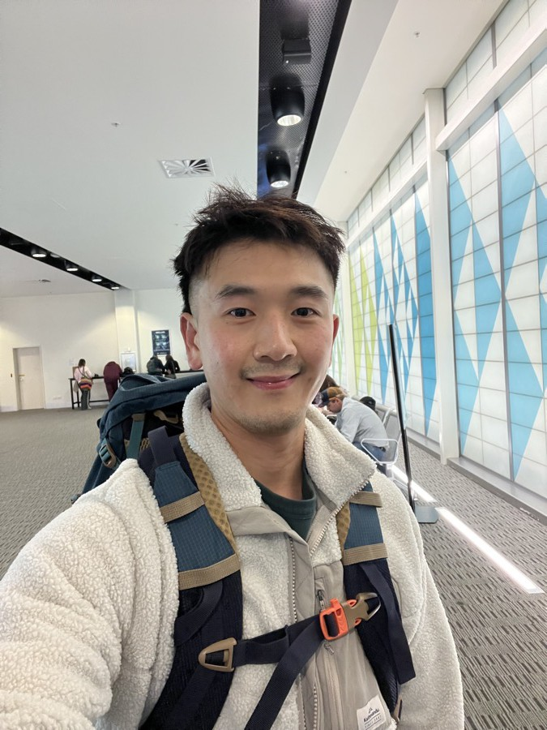

---
# HOME PAGE. The block between the --- lines is this page's settings.
pagetitle: "Yoky Treerasoradaj"
toc: false
---

<!-- ::: {.name} ... ::: wraps text in a box with that design class (see styles/common.scss) -->

::: {.hero}

<!-- Your photo, with an animated background behind it.
     Which background (waves or rising lines) is chosen in js/hero-bg.js -->
::: {.photo-stage}

{.hero-photo fig-alt="Portrait of Yoky Treerasoradaj"}
:::

[Yoky Treerasoradaj]{.hero-title style="display:block"}

[Medical doctor building medical AI and decision-support tools that improve people's quality of life.]{.hero-tagline style="display:block"}

<!-- Icon links. The email one opens a Gmail "new message" window addressed to you. -->
::: {.icon-links}
<a href="https://www.linkedin.com/in/tnutachat/" target="_blank" rel="noopener" aria-label="LinkedIn" title="LinkedIn"><i class="bi bi-linkedin"></i></a>
<a href="https://scholar.google.com/citations?user=LXX83BoAAAAJ&hl=en" target="_blank" rel="noopener" aria-label="Google Scholar" title="Google Scholar"><svg viewBox="0 0 24 24" width="1em" height="1em" fill="currentColor" aria-hidden="true"><path d="M12 24a7 7 0 1 1 0-14 7 7 0 0 1 0 14zm0-24L0 9.5l4.838 3.94A8 8 0 0 1 12 9a8 8 0 0 1 7.162 4.44L24 9.5z"/></svg></a>
<a href="https://mail.google.com/mail/?view=cm&fs=1&to=tnutachat@gmail.com" target="_blank" rel="noopener" aria-label="Email me" title="Email me"><i class="bi bi-envelope-fill"></i></a>
:::

:::

::: {.card-grid}

::: {.feature-card}
### Medicine

Licensed in Thailand since 2021, I work as a GP with a focus on preventive and longevity medicine. As an intern in a rural hospital during COVID-19, I watched weak data systems slow down care and contribute to deaths that could have been prevented. That was the year I started building data tools alongside treating patients. Since then I've used hospital data to guide [tuberculosis screening](projects/tb-tracking-dss/index.qmd) with Bangkok's public health teams, finding 101 people with suspected TB, more than half of them with no symptoms.
:::

::: {.feature-card}
### Data and AI

My first projects ran on Google Sheets and outgrew them once the data passed a thousand rows. Now I work in SQL, R and Python, and at Monash I build machine learning and time series forecasting models. In class competitions I placed 5th of 340 forecasting Google's stock price, and in the top 10% of 285 teams with an ICU mortality model.
:::

::: {.feature-card}
### Business improvement

I redesign how hospital services run, using LEAN, automation and dashboards. I grew a hospital check-up service more than eightfold by bringing it to companies and communities. A UiPath robot I set up for 1,200 university students cut keying time per student by half, with no reports of repeated vaccine doses or duplicate blood tests in its first year.
:::

:::

::: {.cta-row}
[About me](about.qmd){.btn-pill} [See my projects](projects/index.qmd){.btn-pill .ghost} [Download CV](files/Yoky-Treerasoradaj-CV.pdf){.btn-pill .ghost}
:::

<!-- Rising lines kept for later; to try it again, uncomment the next line and set DEFAULT in js/hero-bg.js -->
<!--  -->

