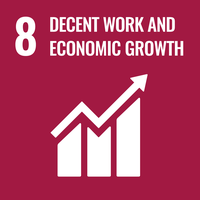
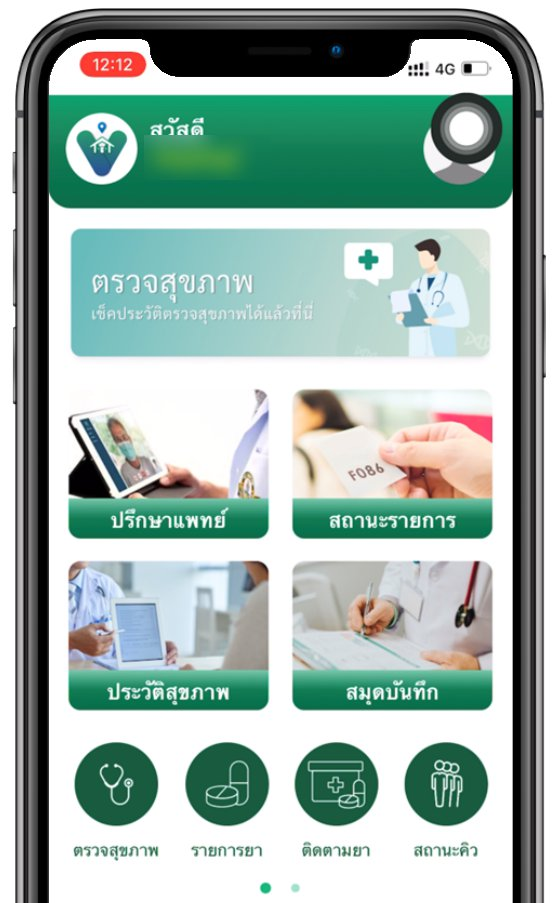
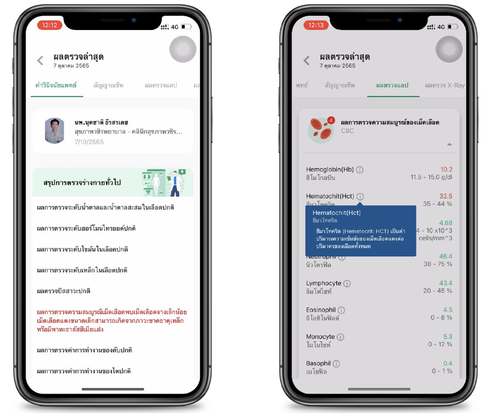

::: {.fact-grid}
::: {.fact}
[Product]{.fact-k}
Vajira at Home patient app, with a report page for doctors
:::
::: {.fact}
[My role]{.fact-k}
Clinical lead: turned the guidelines into report logic
:::
::: {.fact}
[Where]{.fact-k}
Vajira Hospital, Navamindradhiraj University, Bangkok
:::
::: {.fact}
[Team]{.fact-k}
Clinicians and software engineers
:::
::: {.fact}
[Guidelines]{.fact-k}
Thai clinical practice guidelines; ESC guidelines for cardiovascular risk
:::
::: {.fact}
[Status]{.fact-k}
In use since 2022
:::
:::

::: {.impact-band}
::: {.impact}
[8×]{.impact-n}
[check-ups: 1,054 in 2021, 8,526 in Jan–Aug 2023]{.impact-l}
:::
::: {.impact}
[15×]{.impact-n}
[capacity in the busiest month: 191 → 2,884]{.impact-l}
:::
::: {.impact}
[96%]{.impact-n}
[of 2023 reports drafted by the system, approved by a doctor]{.impact-l}
:::
::: {.impact}
[16–60]{.impact-n}
[reports a month still written by hand in 2023]{.impact-l}
:::
:::

## The opportunity

Demand for health check-ups was growing faster than doctors could keep up. Two doctors were each reporting more than 60 check-ups a day by hand: reading every lab result and writing every line of advice. Companies wanted to bring their whole workforce for check-ups, but doctor time capped how many the hospital could accept.

Patients had a problem too. Most health apps in Thailand simply flag results as normal or abnormal. A small, harmless abnormality shows up in red with no explanation, which can cause real anxiety, while the results that matter most don't come with a clear next step.

## What we built

A decision support system behind the hospital's patient app, Vajira at Home. It brings together everything from the check-up, applies the clinical guidelines, and drafts a personal report for the doctor to approve.

::: {.pipeline}
::: {.pl-step}
[1]{.pl-n}
**Collect.** Lifestyle and history from the e-assessment, lab results from the lab system, and imaging.
:::
::: {.pl-step}
[2]{.pl-n}
**Apply the guidelines.** Rules from the Thai clinical practice guidelines and the ESC guidelines suggest the report and the next steps. Healthy results pass straight through.
:::
::: {.pl-step}
[3]{.pl-n}
**Doctor approves.** The suggestion appears on the doctor's page. The doctor checks it, edits if needed and approves.
:::
::: {.pl-step}
[4]{.pl-n}
**Patient reads it.** The report arrives in the app with plain-language explanations of every result.
:::
:::

### Three examples

::: {.case-grid}
::: {.case}
[Patient A]{.case-k}

60 years old, smoker, long-term constipation.

[Suggested]{.case-k}

Colonoscopy screening, as the guideline recommends.
:::
::: {.case}
[Patient B]{.case-k}

30 years old, non-smoker, exercises fewer than 3 days a week, cholesterol 245 mg/dL, no medication.

[Suggested]{.case-k}

Lifestyle changes, and a repeat cholesterol test in 1 to 3 months.
:::
::: {.case}
[Patient C]{.case-k}

Same as patient B, but cholesterol 350 mg/dL.

[Suggested]{.case-k}

Start a statin alongside lifestyle changes.
:::
:::

Each suggestion goes to a doctor before the patient sees it. The system does the reading and the drafting; the doctor keeps the decision.

## The workflow, before and after



## Results: more patients, the same standard



The service grew from 1,054 check-ups in 2021 to 4,373 in 2022, and 8,526 in just the first eight months of 2023. Almost all of the growth came from off-site check-ups for companies, launched in 2022 and run with decision support.



The doctors' workload didn't grow with the volume. In 2023 they wrote only 16 to 60 reports a month by hand, while the service handled up to 2,812 check-ups a month. Everything else arrived as a draft to check and approve.



Numbers are from hospital visit records for the Health Check-up Clinic and off-site company check-ups.

## Who the customers are

::: {.stat-row}
::: {.stat}
[82%]{.stat-n}
[Millennials and Gen X: working-age adults]{.stat-l}
:::
::: {.stat}
[62%]{.stat-n}
[women]{.stat-l}
:::
::: {.stat}
[8,226]{.stat-n}
[off-site check-ups for companies, Jan–Aug 2023]{.stat-l}
:::
:::

Most customers are working-age adults who come through their employers. That makes this a business-to-business model: one agreement with a company brings in hundreds of check-ups at once. Figures are for January to August 2023; generation shares are based on the 7,995 people with a recorded birth year.

## Growing the business without lowering the standard

Good data makes the service more precise for each patient and more valuable for the hospital at the same time. Every check-up feeds the next one.

```{=html}
<figure class="cycle-figure">
<svg class="cycle-svg" viewBox="0 0 640 430" role="img" aria-labelledby="cycle-t">
<title id="cycle-t">The cycle of innovation: collect data, give precise reports, grow the business, support research, then collect better data</title>
<defs><marker id="cy-a" viewBox="0 0 10 10" refX="8" refY="5" markerWidth="7" markerHeight="7" orient="auto"><path d="M0,0 L10,5 L0,10 z" class="cy-head"/></marker></defs>
<path class="cy-arc" d="M392,62 C500,70 545,120 552,168" marker-end="url(#cy-a)"/>
<path class="cy-arc" d="M552,262 C545,310 500,362 392,370" marker-end="url(#cy-a)"/>
<path class="cy-arc" d="M248,370 C140,362 95,310 88,262" marker-end="url(#cy-a)"/>
<path class="cy-arc" d="M88,168 C95,120 140,70 248,62" marker-end="url(#cy-a)"/>
<circle class="cy-core" cx="320" cy="215" r="74"/>
<text class="cy-core-t" x="320" y="208" text-anchor="middle">Cycle of</text>
<text class="cy-core-t" x="320" y="230" text-anchor="middle">innovation</text>
<g class="cy-node"><rect x="230" y="28" width="180" height="70" rx="16"/><text class="cy-n" x="320" y="56" text-anchor="middle">1 · Collect</text><text class="cy-d" x="320" y="78" text-anchor="middle">structured data, every check-up</text></g>
<g class="cy-node"><rect x="450" y="180" width="180" height="70" rx="16"/><text class="cy-n" x="540" y="208" text-anchor="middle">2 · Personalise</text><text class="cy-d" x="540" y="230" text-anchor="middle">precise, guideline-based reports</text></g>
<g class="cy-node"><rect x="230" y="332" width="180" height="70" rx="16"/><text class="cy-n" x="320" y="360" text-anchor="middle">3 · Grow</text><text class="cy-d" x="320" y="382" text-anchor="middle">more companies, new services</text></g>
<g class="cy-node"><rect x="10" y="180" width="180" height="70" rx="16"/><text class="cy-n" x="100" y="208" text-anchor="middle">4 · Research</text><text class="cy-d" x="100" y="230" text-anchor="middle">better evidence, better rules</text></g>
</svg>
</figure>
```

- **Collect.** Every check-up adds structured lifestyle, lab and imaging data to the hospital record.
- **Personalise.** The same data gives each patient a precise report and a clear next step, instead of a list of red flags.
- **Grow.** Doctor time stops being the limit, so the hospital can take on more companies. The reports also point to services each person actually needs, such as vaccinations, exercise programmes, nutrition advice and follow-up by telemedicine.
- **Research.** With consent and proper governance, the growing dataset supports future health research, which in turn improves the rules.

### Quality and privacy safeguards

- A doctor approves every report before the patient sees it.
- The logic follows published guidelines: the Thai clinical practice guidelines, and the ESC guidelines for cardiovascular risk.
- All data stays in the hospital information system, and a data sharing agreement and a data processing agreement are signed with every client company.

## What's next

- **Longevity check-ups.** Adding genetic testing and VO2max testing, so the same model can serve preventive and longevity medicine.
- **Rebuilding the logic as code.** I designed the clinical content; I'm now rewriting the rules as tested, reproducible code so they can be updated and shared with other hospitals.
- **In the real world.** The system supported the [One Million Health Check-up Campaign](../health-check-campaign/index.qmd) in the Dusit and District 4 zone, around 33,000 free check-ups.

## Recognition

- Innowhale Award, Health Promotion Accelerator, Thai Health Promotion Foundation (2022), for this project

::: {.sdg-row .sdg-project}
{fig-alt="UN Sustainable Development Goal 3: Good health and well-being"}
{fig-alt="UN Sustainable Development Goal 8: Decent work and economic growth"}
:::

## Screenshots

::: {.shots}
{fig-alt="Phone screen of the Vajira at Home app showing the health check-up menu"}

{fig-alt="Two phone screens: a doctor's summary of check-up results, and a list of blood test results with an explanation pop-up"}
:::
