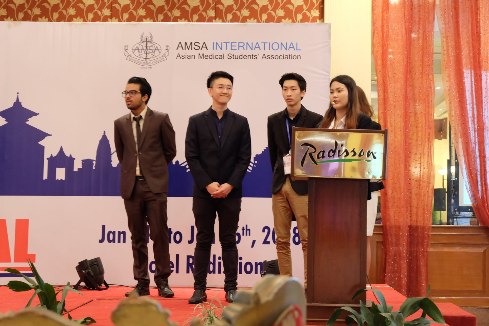
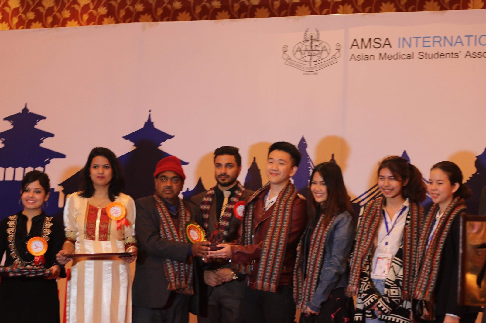
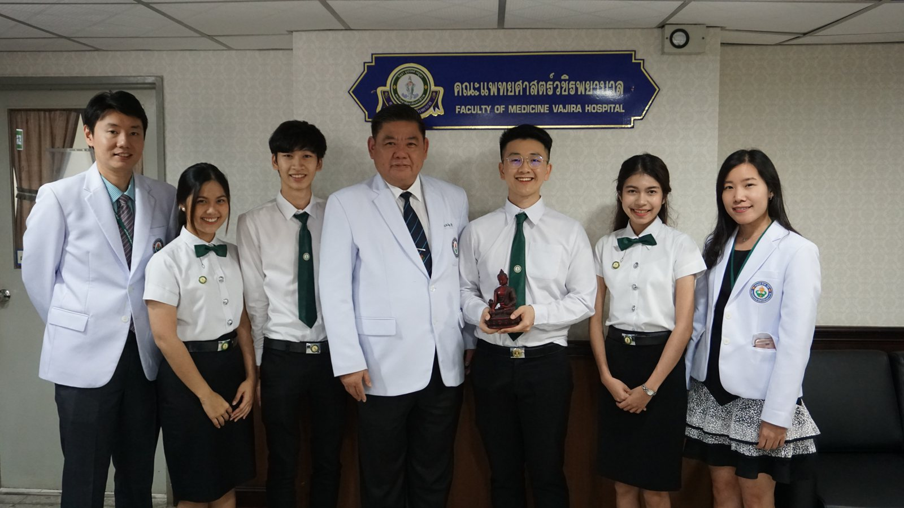
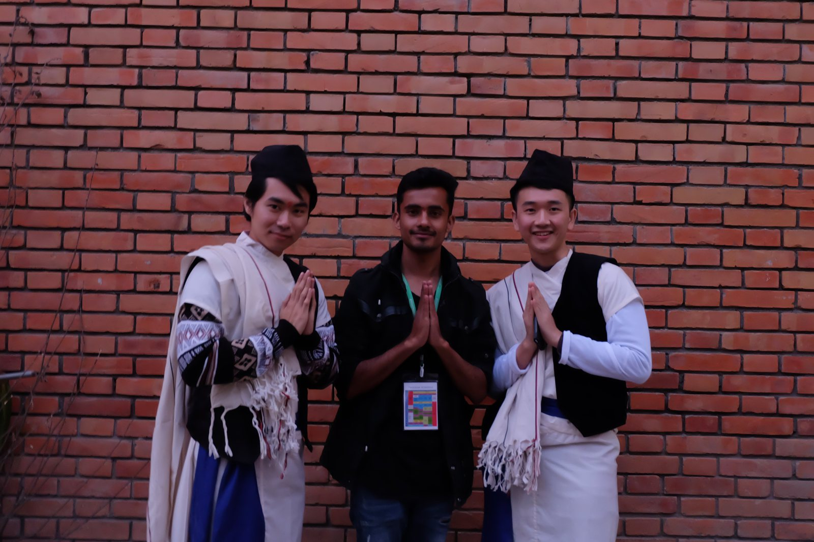
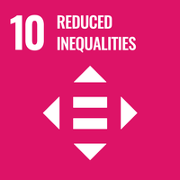

::: {.fact-grid}
::: {.fact}
[Event]{.fact-k}
East Asian Medical Students' Conference (EAMSC) 2018, AMSA International
:::
::: {.fact}
[Where and when]{.fact-k}
Kathmandu, Nepal · January 2018
:::
::: {.fact}
[Topic]{.fact-k}
Hepatitis B passed from mother to child in Thailand, and the role of vaccination
:::
::: {.fact}
[My role]{.fact-k}
Initiator and team leader
:::
::: {.fact}
[Team]{.fact-k}
Four medical students from Vajira
:::
::: {.fact}
[Result]{.fact-k}
**Winner**, White Paper and Video Competition
:::
:::

## The theme: hepatitis B

Hepatitis B was the theme of EAMSC 2018. Within it, our team chose to focus on the route that matters most in Thailand: from mother to baby.

Hepatitis B is a virus that attacks the liver. In adults, most infections clear up. In newborns it's the opposite: a baby infected at birth will very likely carry the virus for life, with a much higher risk of cirrhosis and liver cancer decades later. In countries like Thailand, the most common route has been from mother to baby around the time of birth.

That makes it one of the clearest cases for prevention in medicine. A vaccine given to the baby right after birth stops most of these infections, and Thailand has given hepatitis B vaccine to all newborns through its national immunisation programme for decades. But the protection isn't perfect, and a small share of babies are still infected.

## What we did

Our team reviewed the published research to show how much Thailand's hepatitis B vaccination scheme has reduced transmission from mother to child, and where the remaining gap lies. We turned the findings into two pieces:

::: {.case-grid .case-grid-2}
::: {.case}
[White paper]{.case-k}

A written review of the evidence on mother-to-child transmission in Thailand and on the impact of the national vaccination scheme.
:::
::: {.case}
[Animated video]{.case-k}

A three-minute animation that tells the same story to anyone, not just doctors: a mother, her newborn, a virus that wants to take over the baby's liver, and the vaccine that stops it.
:::
:::

### The video

```{=html}
<figure class="video-figure">
<video controls preload="none" playsinline poster="images/video-poster.jpg" aria-label="Animated video: hepatitis B transmission from mother to child">
<source src="video/hepatitis-b-mother-to-child.mp4" type="video/mp4">
Your browser can't play this video.
</video>
<figcaption>Our winning animation (3 minutes, on-screen text in English). The virus is a king trying to take the baby's liver castle. The doctor's vaccine defends it, but in about one baby in ten the vaccine alone isn't enough.</figcaption>
</figure>
```

## Building the team

Nobody asked us to enter. I saw the competition, chose our angle on the theme and invited three classmates I knew would do excellent work. Then I split the work into two parts, reviewing and writing the evidence, and making the animation, and matched each person to the part they did best. My job was to keep the two halves telling one story and to deliver on time.

We had no funding. Everything came from our own time, between classes and exams.

## Presenting in Kathmandu

We presented our work to medical students and judges from across East Asia at the conference in Kathmandu, and won.

::: {.photo-grid}
{fig-alt="Four students in suits standing on stage in front of an AMSA International banner, one speaking at a podium"}

{fig-alt="Students wearing traditional Nepali scarves receiving an award on stage"}

{fig-alt="Medical students and faculty members in white coats standing under the Faculty of Medicine Vajira Hospital sign, one holding a trophy"}

{fig-alt="Three students in traditional Nepali dress greeting with joined hands in front of a brick wall"}
:::

## What it started

Looking back, this project set the direction for most of my work since:

- **Prevention first.** Stopping disease before it starts is still the thread through my work, from [student vaccination](../rpa-vaccination/index.qmd) and [health check-ups](../health-check-campaign/index.qmd) to [finding TB early](../tb-tracking-dss/index.qmd).
- **Evidence into action.** It was my first time pulling research and data together to argue for a health policy, which is now my daily work.
- **Leading a team from an idea.** I started it, recruited the people and put each in the right role, the same way I've started projects ever since.
- **Telling the story clearly.** A good animation reached more people than the paper alone. I still try to make every result easy to understand.

## Recognition

- Winner, White Paper and Video Competition, East Asian Medical Students' Conference 2018, Asian Medical Students' Association (AMSA International), Kathmandu ([EAMSC 2018 page](https://www.facebook.com/EAMSC2018))

::: {.sdg-row .sdg-project}
{fig-alt="UN Sustainable Development Goal 3: Good health and well-being"}
{fig-alt="UN Sustainable Development Goal 10: Reduced inequalities"}
:::
