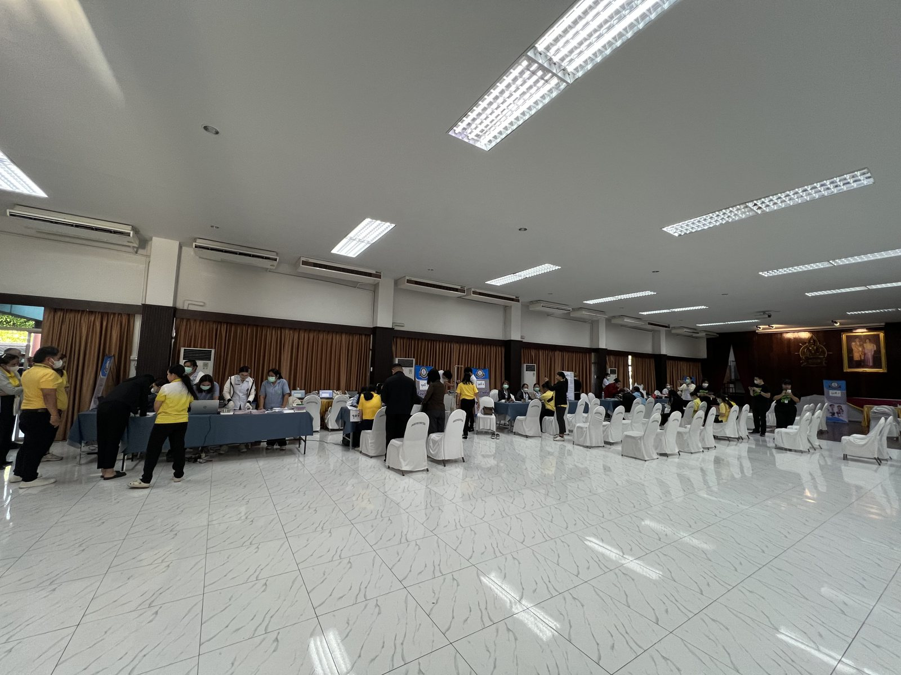
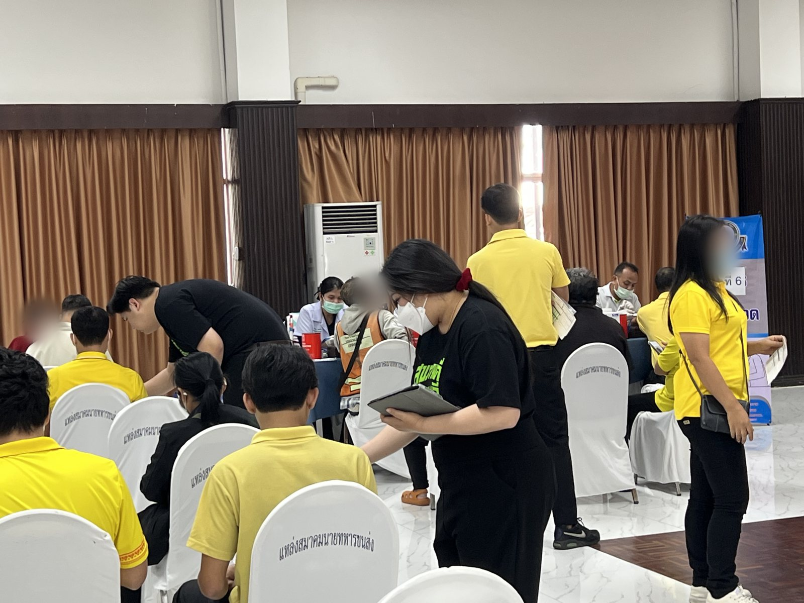
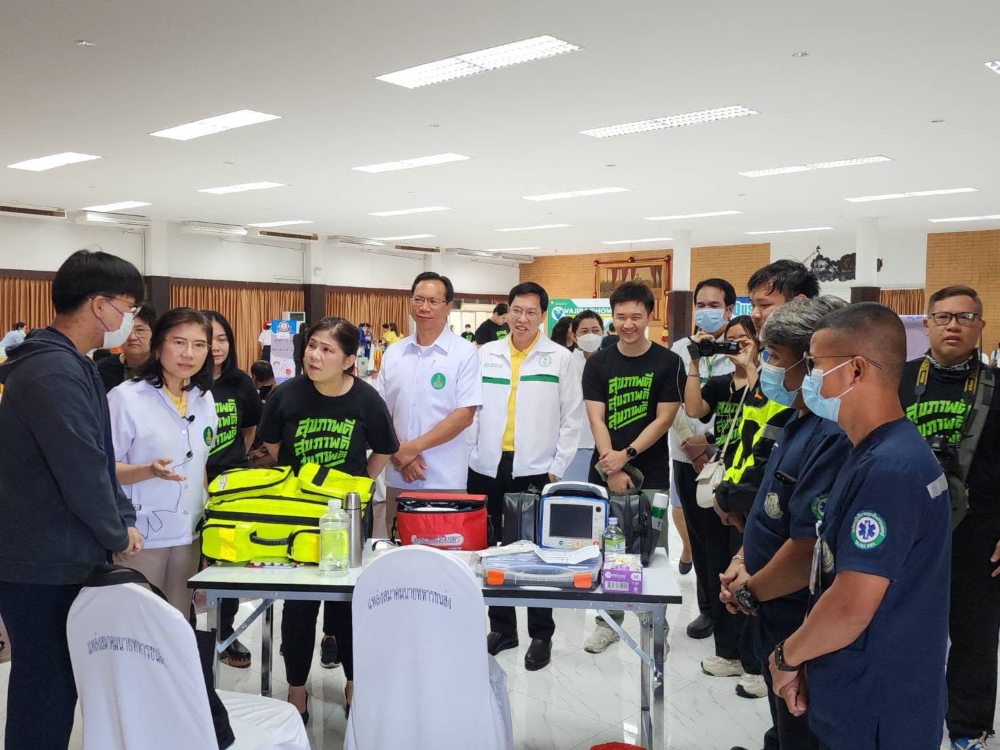
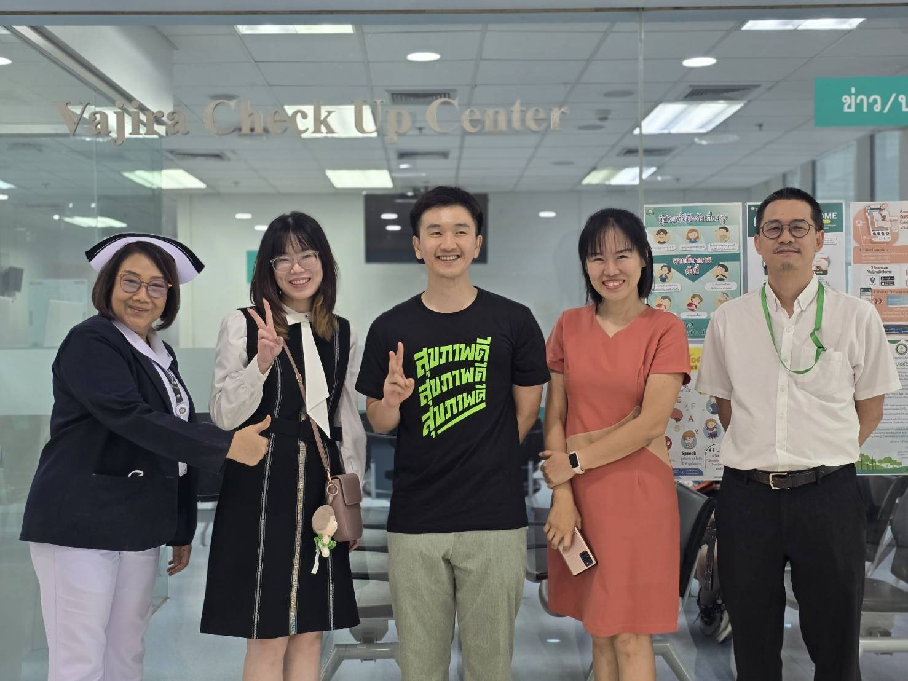
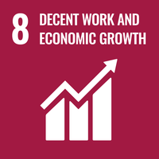
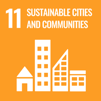

::: {.fact-grid}
::: {.fact}
[Programmes]{.fact-k}
Off-site health check-ups for companies, and Vajira Hospital's unit in Bangkok's One Million free health check-up caravan
:::
::: {.fact}
[My role]{.fact-k}
Project manager: workflow design, shared digital workspace, dashboard and partner coordination
:::
::: {.fact}
[Where]{.fact-k}
Vajira Hospital Check Up Center, workplaces across Bangkok, and communities in the Dusit and District 4 zone
:::
::: {.fact}
[Partners]{.fact-k}
Bangkok Metropolitan Administration (BMA) Medical Service Department, Health Department and Dusit District Office; client companies
:::
::: {.fact}
[Built on]{.fact-k}
[Clinical decision support](../clinical-decision-support-app/index.qmd) for check-up reports, LEAN patient flow, a BI dashboard
:::
::: {.fact}
[Years]{.fact-k}
2022 – 2025
:::
:::

::: {.impact-band}
::: {.impact}
[8×]{.impact-n}
[check-ups: 1,054 in 2021, 8,526 in Jan–Aug 2023]{.impact-l}
:::
::: {.impact}
[8,226]{.impact-n}
[off-site check-ups for companies in eight months]{.impact-l}
:::
::: {.impact}
[96%]{.impact-n}
[of reports drafted by decision support]{.impact-l}
:::
::: {.impact}
[~33,000]{.impact-n}
[free check-ups by our unit in the One Million campaign]{.impact-l}
:::
:::

## The idea: one system, two missions

Most chronic diseases, such as diabetes, high blood pressure and high cholesterol, can be found years before they cause harm. A health check-up is the cheapest moment to catch them. The problem is scale: every check-up needs a doctor to read the results and write advice, and doctor time runs out long before demand does.

I managed two programmes that ran on the same answer to that problem.

::: {.case-grid .case-grid-2}
::: {.case}
[Mission 1 · Business]{.case-k}

**Off-site check-ups for companies.** The hospital takes its check-up service to the workplace. One agreement with a company brings in hundreds of employees at once, and the income helps the hospital fund its other services.
:::
::: {.case}
[Mission 2 · Public health]{.case-k}

**Free check-ups for the community.** Bangkok's One Million Health Check-up campaign brings free screening to people who rarely see a doctor. Vajira Hospital ran a mobile unit as part of it, covering the Dusit and District 4 zone.
:::
:::

Both depended on the same three things: a fast, well-organised check-up day, reports that don't wait for a doctor's free hour, and partners who bring the people.

## How the workflow fits together

::: {.pipeline}
::: {.pl-step}
[1]{.pl-n}
**Plan with the partner.** A company's HR team or a district office agrees the date, the place and who comes. Everyone shares one digital workspace, so the plan, the lists and the updates sit in one place.
:::
::: {.pl-step}
[2]{.pl-n}
**Check-up day.** A LEAN flow takes each person through registration, vital signs, blood tests and imaging in a fixed order, with no back-tracking and fewer queues.
:::
::: {.pl-step}
[3]{.pl-n}
**Decision support drafts the report.** Rules from Thai and international guidelines suggest the report and next steps. A doctor checks, edits and approves every one.
:::
::: {.pl-step}
[4]{.pl-n}
**Results and follow-up.** People get plain-language results with a clear next step. The dashboard shows the team how many were seen, what's pending and what needs follow-up.
:::
:::

The decision support system is the engine. Without it, two doctors writing more than 60 reports a day by hand set the ceiling. With it, the same doctors approve drafted reports, and growth is limited by how many partners we can bring in, not by how fast we can type. The full story of that system is on the [clinical decision support page](../clinical-decision-support-app/index.qmd).

## Results: growth without lowering the standard



Check-ups grew from 1,054 in 2021 to 4,373 in 2022, and to 8,526 in only the first eight months of 2023. Almost all of that growth, 8,226 check-ups, came from off-site check-ups for companies. Every report was still approved by a doctor and based on clinical guidelines.

## Taking it to the community: the One Million campaign

In December 2023 the BMA launched a campaign to give at least one million Bangkok residents a free health check-up, with hospitals, medical schools and district offices across all 50 districts ([Nation Thailand](https://www.nationthailand.com/thailand/general/40034086)). By March 2026 it had passed 1,002,629 people ([BMA news](https://pr-bangkok.com/?p=587387)).

Vajira Hospital joined with a mobile check-up caravan for the Dusit and District 4 zone. Our team brought the same workflow, the same digital workspace and the same report system that we had built for companies into the community. **Our unit carried out around 33,000 check-ups, out of roughly 300,000 in the zone.**

**The kick-off, 23 December 2024.** The caravan opened at the Army Transportation Officers' Association in Dusit District, which offered the venue. The first people we screened were motorcycle taxi riders, who spend all day in traffic, strong sun and PM2.5 dust, together with staff of the Dusit District Office. It was a joint effort with the BMA Medical Service Department, the BMA Health Department and the Dusit District Office. Bangkok's Deputy Governor, the Dusit District Director, and Vajira's Dean and Hospital Director came to support the team on the day ([Faculty of Medicine Vajira Hospital](https://www.facebook.com/medvjr.official/)).

::: {.photo-grid}
{fig-alt="A large hall with screening desks along the wall and rows of white chairs for people waiting"}

{fig-alt="Staff in black team shirts guiding people in yellow shirts to screening desks"}

{fig-alt="Officials and staff in black campaign shirts gathered around a table of emergency equipment"}

{fig-alt="Five members of the check-up team smiling in front of the Vajira Check Up Center sign"}
:::

## Working across organisations

::: {.case-grid}
::: {.case}
[Vajira Hospital]{.case-k}

- Check Up Center: doctors, nurses and staff on every check-up day
- Software engineers: the patient app and decision support
- Faculty and hospital leadership: backing to scale up
:::
::: {.case}
[Bangkok Metropolitan Administration]{.case-k}

- Medical Service Department and Health Department: the One Million campaign
- Dusit District Office: reaching local groups and organising the venue
:::
::: {.case}
[Companies and community hosts]{.case-k}

- Client companies: bringing their whole workforce, with data sharing and data processing agreements signed
- Community hosts, such as the Army Transportation Department: venues close to where people work
:::
:::

What I learned is that partnerships are the real channel. One conversation with an HR manager or a district director can reach more people than months of waiting for walk-ins.

## Why it matters

::: {.case-grid}
::: {.case}
[Timely]{.case-k}

Chronic disease is found at a check-up, years before it becomes a stroke or a heart attack.
:::
::: {.case}
[Equitable]{.case-k}

Free screening goes to motorcycle taxi riders and other workers who can't easily take a day off to see a doctor.
:::
::: {.case}
[Efficient]{.case-k}

Doctors approve drafted reports instead of writing each one, so more people can be seen without more doctors.
:::
:::

## Building something bigger

The check-up programmes, the [TB VFind](../tb-tracking-dss/index.qmd) screening loop and the decision support system all point the same way: prevention works best when data, clinical rules and partners are joined up.

- **One record across services.** Today a person may be screened by a caravan, a company check-up and a health centre, and each keeps its own record. Linking them would end repeated tests and show each person's health over time.
- **Follow-up close to home.** Abnormal results could go straight to the BMA health centre nearest the person's home, the way TB VFind already refers suspected TB cases.
- **Population health insight.** With consent and proper governance, the combined data could show each district's health risks and guide where to screen next.
- **Longevity and precision prevention.** The same model can grow into longevity check-ups, adding genetic and fitness testing.

The 33,000 figure is our unit's total; the citywide total comes from the BMA.

::: {.sdg-row .sdg-project}
{fig-alt="UN Sustainable Development Goal 3: Good health and well-being"}
{fig-alt="UN Sustainable Development Goal 8: Decent work and economic growth"}
{fig-alt="UN Sustainable Development Goal 11: Sustainable cities and communities"}
:::
