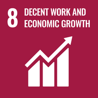
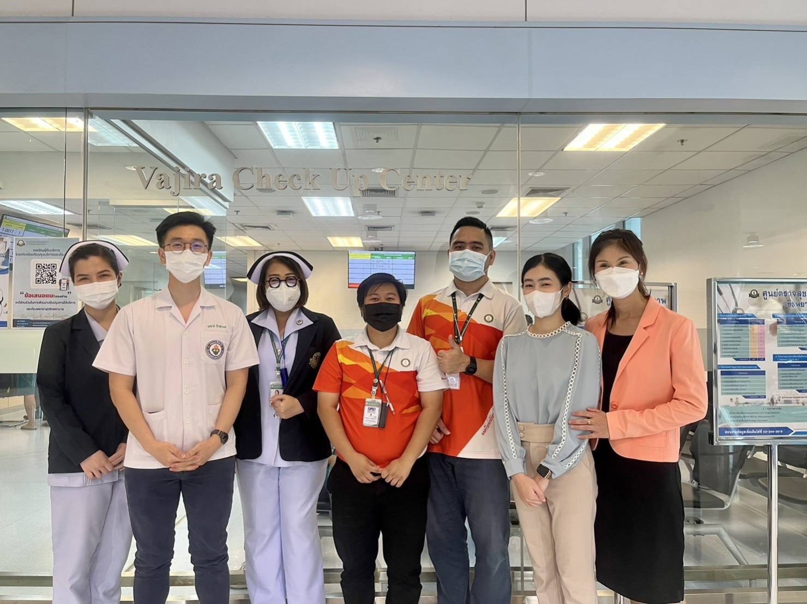

---
# PROJECT PAGE. Every project page uses the same sections, in the same order:
# Snapshot → Impact band → Problem → What I built → Workflow → Data → Skills →
# Outcome → Contribution to healthcare → What happened next → Photos.
title: "Data-Assisted Student Vaccination"
subtitle: "Risk-based screening and a UiPath robot for 1,200 university students"
description: "1,200 safe immunisations a year, more than 50% less staff time per student, and no repeat doses or duplicate blood tests."
years: "2022 – 2024"     # shown on the Projects card
date: 2022-06-01      # start of the project: sorts the cards, newest first
image: cover.jpg      # the picture on the Projects card
categories: [RPA, Vaccination, Patient safety, Workflow redesign, Google Sheets, SQL]
toc: true
---

::: {.fact-grid}
::: {.fact}
[Years]{.fact-k}
2022 – 2024
:::
::: {.fact}
[My role]{.fact-k}
Initiator and project manager
:::
::: {.fact}
[Where]{.fact-k}
Vajira Hospital, Navamindradhiraj University (NMU), Bangkok
:::
::: {.fact}
[Team]{.fact-k}
Student health check-up team
:::
::: {.fact}
[Tools]{.fact-k}
UiPath · Google Sheets · Google Forms · SQL
:::
::: {.fact}
[Funding]{.fact-k}
None. Self-initiated
:::
:::

::: {.impact-band}
::: {.impact}
[1,200]{.impact-n}
[safe immunisations every year]{.impact-l}
:::
::: {.impact}
[>50%]{.impact-n}
[less staff time per student]{.impact-l}
:::
::: {.impact}
[Zero]{.impact-n}
[keying burden on nurses and doctors]{.impact-l}
:::
::: {.impact}
[0]{.impact-n}
[cost from repeat doses or duplicate tests]{.impact-l}
:::
:::

## The problem

Every year, new NMU students come to Vajira Hospital for a health check and vaccinations before they start. Healthcare students also need proof of immunity, so they are tested for hepatitis B and varicella (VZV IgG, HBsAg, anti-HBs).

Before this project, staff checked each student's vaccine and lab history by eye in the hospital information system (HIS), and doctors keyed every vaccine order by hand. With around 1,200 students, the checks failed often. In the year before I started, some students received three or four doses of the same vaccine, and some had the same VZV IgG test three to five times in one year. Each repeat meant an unnecessary needle, a cost to the hospital, and staff time taken away from patients.

## What I built

The aim was to give staff their time back: nurses back with patients, and doctors free to focus on the high-risk cases.

1. **Pull the history from the record.** I asked V-Wisdom, the hospital's data team, to extract every student's immunisation and lab history from the electronic medical record.
2. **Sort students by risk.** In Google Sheets I grouped students into healthcare and non-healthcare programmes, with subgroups based on their medical history.
3. **Screen before the needle.** I designed an online risk assessment in Google Forms that every student completes before receiving a vaccine.
4. **Let a robot do the keying.** I built a low-code UiPath robot that opens each visit and keys the lab and vaccine orders into the HIS. Clinicians reviewed every item before it went through.

## The workflow, before and after



## Data and privacy

- **Sources:** immunisation history and lab results from the hospital's electronic medical record, extracted with SQL by the V-Wisdom data team.
- **Scale:** about 1,200 students per intake.
- **Storage:** kept only on the hospital's own drive, and sensitive data was deleted at the end of every year.
- **Access:** only the healthcare vaccination team could see it.
- **Safety check:** every order the robot keyed was reviewed by a clinician.

## Skills and technology

| Tool | What I used it for |
|---|---|
| UiPath (low-code RPA) | Opening visits and keying lab and vaccine orders into the HIS |
| Google Forms | Online risk assessment before vaccination |
| Google Sheets | Grouping students by programme and medical history, and analysing lab results |
| SQL | Extracting immunisation and lab history from the medical record (with the data team) |

UiPath was new to me on this project. The hardest part was teaching the robot to work precisely on the HIS screens, which were designed for people to click through by hand.

**Then and now.** I'd build it differently today. Instead of a robot clicking through screens, I'd connect to the hospital system through an API, keep the data in a proper database, and make the whole pipeline reproducible so another team could run it without me. I'd also design the safety checks into the system from the start.

## Outcome

| Measure | Before | After (first year) |
|---|---|---|
| Keying time per student | 10 minutes | under 5 minutes |
| Time to process the whole intake | 5 days | 2 days |
| Repeat doses and duplicate lab tests | Several students affected | None reported |
| Staff workload | High, with hours spent on the system | Still busy, but nobody had to spend their time keying |

The numbers come from HIS records.

## Contribution to healthcare

- **Safe:** every student is screened for risk before vaccination, and no student was harmed by an extra, unneeded dose.
- **Effective:** students get the vaccines and tests their history says they need, and only those.
- **Patient-centred:** the system uses data management to put each student's safety first.
- **Timely:** the whole intake is processed in two days instead of five.
- **Efficient:** half the keying time per student, and no money spent on duplicate tests.
- **Equitable:** every student goes through the same risk-based check.

::: {.sdg-row .sdg-project}
{fig-alt="UN Sustainable Development Goal 3: Good health and well-being"}
{fig-alt="UN Sustainable Development Goal 8: Decent work and economic growth"}
:::

## What happened next

The project had no budget, so nobody took it over when I left for Monash in 2025, and the hospital went back to the old process. The hospital did let me trial something new, and I learned a lesson I still use: a project that depends on one person, or on spreadsheets that only one person understands, stops when that person leaves. That's why reproducible data pipelines are now at the centre of how I work.

**Where it could go.** If hospitals coded their medicines with Thailand's standard drug terminology (TMT), the risk grouping could run automatically across many hospitals and help prevent vaccine-preventable disease at a much larger scale.

## Photos

{fig-alt="Seven members of the check-up centre team standing in front of the Vajira Check Up Center"}
