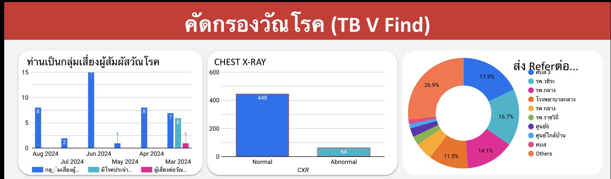
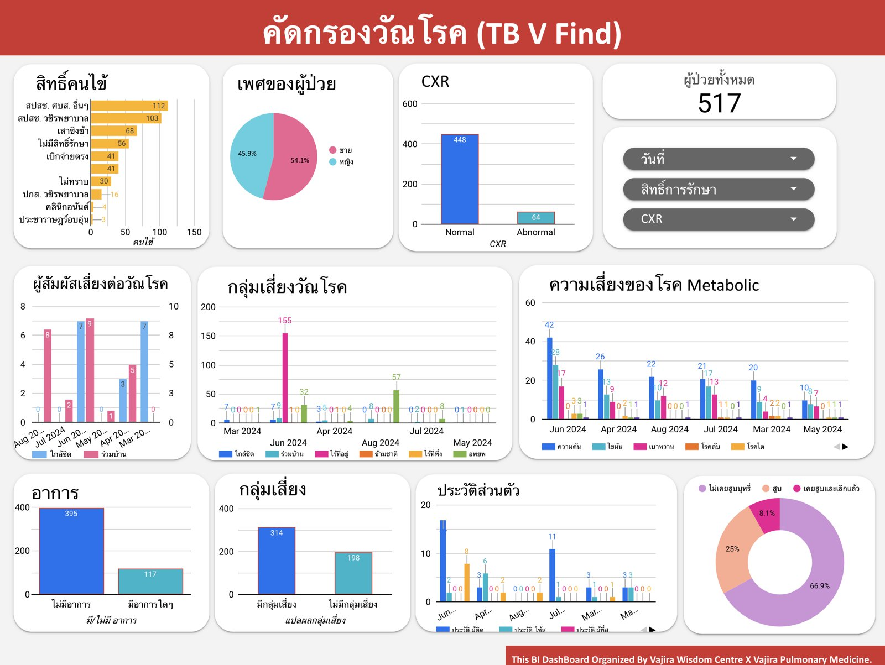
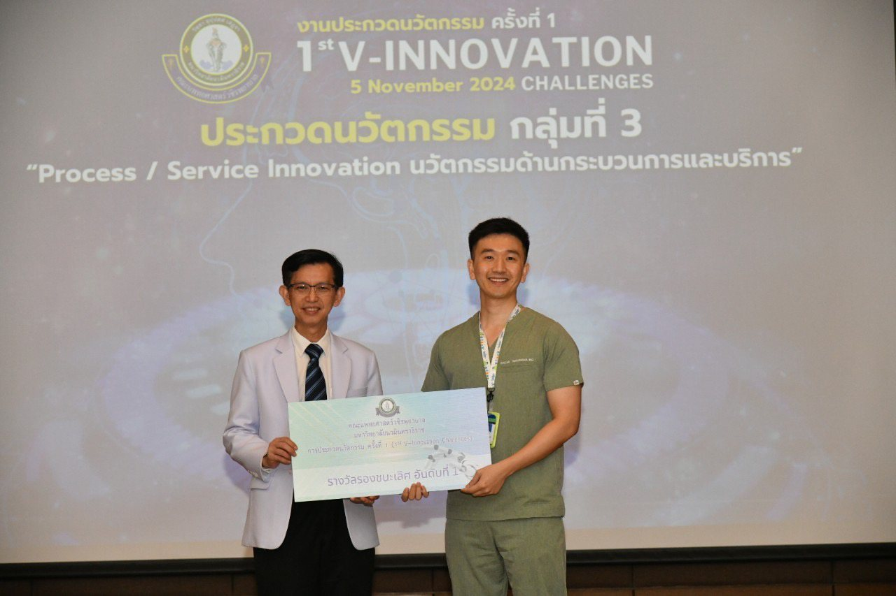
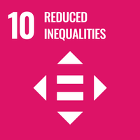
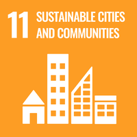

::: {.fact-grid}
::: {.fact}
[Programme]{.fact-k}
TB VFind, part of the "Dusit Model" for ending TB in the community
:::
::: {.fact}
[My role]{.fact-k}
Chief of Innovation: designed the data collection, the dashboard and the tracking workflow
:::
::: {.fact}
[Where]{.fact-k}
Vajira Hospital and communities in Dusit and neighbouring Bangkok districts
:::
::: {.fact}
[Partners]{.fact-k}
Bangkok Metropolitan Administration (BMA) health department and health centres; Fujifilm Thailand (portable X-ray)
:::
::: {.fact}
[Users]{.fact-k}
The hospital TB clinic and public health nurses
:::
::: {.fact}
[Tools]{.fact-k}
Google Forms, Google Sheets, a BI dashboard, ICD-10 coding, R for analysis
:::
:::

::: {.impact-band}
::: {.impact}
[1,978]{.impact-n}
[people screened, 2024–2026]{.impact-l}
:::
::: {.impact}
[101]{.impact-n}
[suspected TB found and referred]{.impact-l}
:::
::: {.impact}
[56%]{.impact-n}
[of them had no symptoms]{.impact-l}
:::
::: {.impact}
[2×]{.impact-n}
[faster data process]{.impact-l}
:::
:::

## Why it matters

Tuberculosis is curable, but it still spreads quietly in Bangkok. Bangkok reports more TB cases than any other province in Thailand, and many people carry the disease for months before they feel sick enough to see a doctor. By then, they may have passed it on to their family, neighbours and co-workers.

Waiting for patients to walk into a clinic finds TB late. **Active case finding** turns that around: the health team goes to the people most at risk, screens them with a chest X-ray and starts care early. The hard part is knowing where to go. That is a data problem, and it's the part I worked on.

## Using hospital data to decide where to screen

Every new TB patient at Vajira Hospital already has an address in the hospital record. On its own that's just a field in a form. Put together, every three months, it becomes a map of where TB is active right now.

```{=html}
<figure class="cycle-figure">
<svg class="cycle-svg" viewBox="0 0 640 430" role="img" aria-labelledby="tb-cycle-t">
<title id="tb-cycle-t">The TB VFind loop: collect new TB cases, map hotspots, screen with BMA teams, refer and track, then collect again</title>
<defs><marker id="tb-a" viewBox="0 0 10 10" refX="8" refY="5" markerWidth="7" markerHeight="7" orient="auto"><path d="M0,0 L10,5 L0,10 z" class="cy-head"/></marker></defs>
<path class="cy-arc" d="M392,62 C500,70 545,120 552,168" marker-end="url(#tb-a)"/>
<path class="cy-arc" d="M552,262 C545,310 500,362 392,370" marker-end="url(#tb-a)"/>
<path class="cy-arc" d="M248,370 C140,362 95,310 88,262" marker-end="url(#tb-a)"/>
<path class="cy-arc" d="M88,168 C95,120 140,70 248,62" marker-end="url(#tb-a)"/>
<circle class="cy-core" cx="320" cy="215" r="74"/>
<text class="cy-core-t" x="320" y="208" text-anchor="middle">Every</text>
<text class="cy-core-t" x="320" y="230" text-anchor="middle">3 months</text>
<g class="cy-node"><rect x="230" y="28" width="180" height="70" rx="16"/><text class="cy-n" x="320" y="56" text-anchor="middle">1 · Collect</text><text class="cy-d" x="320" y="78" text-anchor="middle">new TB cases and addresses</text></g>
<g class="cy-node"><rect x="450" y="180" width="180" height="70" rx="16"/><text class="cy-n" x="540" y="208" text-anchor="middle">2 · Map</text><text class="cy-d" x="540" y="230" text-anchor="middle">hotspots on the dashboard</text></g>
<g class="cy-node"><rect x="230" y="332" width="180" height="70" rx="16"/><text class="cy-n" x="320" y="360" text-anchor="middle">3 · Screen</text><text class="cy-d" x="320" y="382" text-anchor="middle">with BMA teams, on site</text></g>
<g class="cy-node"><rect x="10" y="180" width="180" height="70" rx="16"/><text class="cy-n" x="100" y="208" text-anchor="middle">4 · Refer, track</text><text class="cy-d" x="100" y="230" text-anchor="middle">to the nearest BMA service</text></g>
</svg>
</figure>
```

1. **Collect.** Every three months, we pull the new TB cases from the hospital record, with the district and street of each patient's home.
2. **Map.** The BI dashboard shows where new cases are clustering. Those hotspots are where the next round of screening goes.
3. **Screen.** Together with BMA public health teams, we go to the hotspot communities with a portable X-ray machine. Each person answers a short, structured set of risk questions and has a chest X-ray on the spot.
4. **Refer and track.** Anyone with suspected TB is referred to a named service, usually the BMA health centre or hospital closest to home, and the team follows them up there.

Then the loop starts again with fresh data, so the screening keeps moving to where it is needed most.

## Turning free text into data we can use

Before TB VFind, TB history was written as free text in the hospital information system. It was readable by a doctor, but impossible to count, compare or map. I redesigned the collection so each answer became a structured field from the start.

::: {.pipeline}
::: {.pl-step}
[1]{.pl-n}
**Structured form.** A TB VFind form in Google Forms replaces free-text notes: contact history, risk groups, symptoms, smoking, chronic disease, X-ray result.
:::
::: {.pl-step}
[2]{.pl-n}
**One shared sheet.** Answers land in Google Sheets, where ICD-10 codes, risk group and incidence are calculated automatically.
:::
::: {.pl-step}
[3]{.pl-n}
**Live dashboard.** A BI dashboard shows X-ray results, risk groups, referrals and hotspots, filtered by date, district and insurance scheme.
:::
::: {.pl-step}
[4]{.pl-n}
**Shared with partners.** Clean, coded data can be shared with BMA services and exported for the national TB programme, instead of re-typed.
:::
:::

With the data structured and coded from the start, our team found the whole process about twice as fast: no re-typing, no manual counting, and the dashboard updates itself.

::: {.shots .shots-wide}
{fig-alt="Dashboard with bar charts of normal and abnormal chest X-rays, a breakdown of abnormal results into suspected TB with or without cavity, and a donut chart of referral destinations"}

{fig-alt="Dashboard with charts of insurance scheme, sex, TB contacts, risk groups, metabolic disease, symptoms and smoking"}
:::

Both screenshots are from August 2024, part-way through the first year. Patient lists and the case map are left out to protect privacy.

## Working as one team across Bangkok

TB doesn't stop at a hospital's front door, so neither could the project. It only works because people inside and outside the hospital share the same data and the same goal.

::: {.case-grid}
::: {.case}
[Inside Vajira Hospital]{.case-k}

- Pulmonary medicine and the TB clinic: clinical lead and diagnosis
- Vajira Wisdom Centre: the BI dashboard
- The ARI clinic: further tests for people referred to the hospital
:::
::: {.case}
[Bangkok Metropolitan Administration]{.case-k}

- BMA health department: planning where and when to screen
- BMA public health centres and their nurses: community screening and follow-up close to home
- BMA hospitals, such as Klang Hospital: further tests and care
:::
::: {.case}
[Outside partners]{.case-k}

- Fujifilm Thailand: the portable X-ray system used in the community ([news release, March 2024](https://www.fujifilm.com/th/en/news/fujifilm-portable-x-ray-system-chosen))
- National TB programme: case reporting and standards
:::
:::

The referral is the key moment. **Every one of the 101 people with suspected TB was referred to a named service: 76 to BMA health centres and other public health services near home, and 25 to Vajira Hospital's ARI clinic.** Because the BMA network covers primary care across the city, patients can be followed up where they live, which is what keeps them on treatment.

## What the data shows



Between March 2024 and July 2026, the teams screened 1,978 people. One in eight had an abnormal chest X-ray, and 101 people, about 1 in 20 of everyone screened, had an X-ray that looked like TB.



This is the strongest case for going out to find TB. **57 of the 101 people with suspected TB had no symptoms.** If we had only screened people who said they had a cough, more than half of them would have been missed, and they would have kept living, working and sharing rooms with others without knowing.



Over three rounds of the loop, the share of people with suspected TB fell from 6.2% of those screened in 2024 to 5.1% in 2025 and 2.5% in the first seven months of 2026. This is what we hoped to see as cases in the hotspots are found and treated. It isn't proof on its own: the communities screened change from round to round, and 2026 is a part year. That is why the next step is better, standardised data.

Of the 19 suspected cases with a final diagnosis recorded back in our sheet so far, 8 were confirmed active TB. The rest of the follow-up happens in BMA services, which is exactly why shared data matters.

## Why prevention is worth it

Finding one person with TB early protects more than one person. The WHO estimates that someone with untreated active TB can infect 10 to 15 other people in a year. Every early case stops a chain of new ones, and treating TB early is simpler, shorter and kinder than treating it late.

It pays off for the health system too. Japan is a good example. In 1955, TB took up 27.4% of the country's medical spending. After decades of sustained TB control, it had fallen to 0.08% by 2011. Our team estimates that scaling a data-driven approach like TB VFind could save Thailand around **฿70 million a year** in TB control costs. That is our projection, not a measured result.

### Better quality of care

::: {.case-grid}
::: {.case}
[Timely]{.case-k}

TB is found before symptoms start, in 56% of the suspected cases.
:::
::: {.case}
[Equitable]{.case-k}

Screening goes to crowded communities, migrants and people without insurance, who rarely come to a hospital first.
:::
::: {.case}
[Patient-centred]{.case-k}

X-rays happen in the community, and follow-up is at the health centre closest to home.
:::
::: {.case}
[Effective]{.case-k}

Hotspot data sends screening to the places with the most new cases.
:::
::: {.case}
[Efficient]{.case-k}

Structured data and automatic coding make reporting about twice as fast, with no re-typing.
:::
::: {.case}
[Safe]{.case-k}

Every suspected case has a named referral and is tracked, so fewer people are lost between services.
:::
:::

## What's next

- **Data standardisation.** Agree on shared data standards for TB tracking across hospitals and BMA services, so results can be compared fairly over time.
- **A custom application.** Move from Google Workspace to a long-term, purpose-built system.
- **Wider collaboration.** Work with digital-economy partners, including telecom companies, to reach more communities.
- **A health data centre.** Lay the groundwork for a standardised health data centre that supports future research and ASEAN-wide collaboration.

TB VFind supports Thailand's operational plan to end TB and the global goal to end the TB epidemic by 2030.

## Recognition

- First runner-up, Process and Service Innovation, 1st V-Innovation Challenge, Faculty of Medicine Vajira Hospital, Navamindradhiraj University (5 November 2024)

{.award-photo fig-alt="Yoky in green scrubs receiving an award certificate from a faculty member in front of a screen reading 1st V-Innovation Challenges, 5 November 2024"}

::: {.sdg-row .sdg-project}
{fig-alt="UN Sustainable Development Goal 3: Good health and well-being"}
{fig-alt="UN Sustainable Development Goal 10: Reduced inequalities"}
{fig-alt="UN Sustainable Development Goal 11: Sustainable cities and communities"}
:::

Built by the Vajira Alumni Team, founded by Dr Pipu Tavornshevin. All figures on this page are totals from the TB VFind screening records; no patient details are shown.
