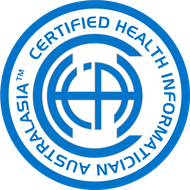

---
# แนะนำตัว (ภาษาไทย). The ONLY Thai page on the site; a short version of about.qmd.
# Names of places, universities, degrees and certificates stay in English on purpose.
# Thai text was drafted by Claude. Please read it and correct anything awkward.
title: "นุตชาติ ธีรสรเดช (Yoky Treerasoradaj)"
subtitle: "แพทย์ และนักพัฒนาข้อมูลสุขภาพและ AI"
toc-depth: 2
---

::: {.profile-links}
[ดาวน์โหลด CV (PDF)](../files/Yoky-Treerasoradaj-CV.pdf){.primary}
[LinkedIn](https://www.linkedin.com/in/tnutachat/)
[อีเมล](mailto:tnutachat@gmail.com)
[English version](../about.qmd)
:::

## ประวัติโดยย่อ

แพทย์ที่มีประสบการณ์ด้านเวชปฏิบัติและระบบสุขภาพในประเทศไทยกว่าห้าปี ปัจจุบันศึกษา Master of Health Data Analytics ที่ Monash University, Melbourne ด้วยทุน Australia for ASEAN Scholarship

จุดเปลี่ยนเกิดขึ้นในปี 2021 ระหว่างเป็นแพทย์เพิ่มพูนทักษะในโรงพยาบาลต่างจังหวัดช่วง COVID-19 ได้เห็นว่าระบบข้อมูลที่ไม่ดีทำให้การรักษาล่าช้า บุคลากรหมดแรง และผู้ป่วยบางรายเสียชีวิตทั้งที่ป้องกันได้ ตั้งแต่นั้นจึงใช้ข้อมูลเพื่อสามเรื่อง คือ ทำให้การรักษาปลอดภัยขึ้น คืนเวลาให้บุคลากร และลดต้นทุนที่สูญเปล่า

## ความสนใจหลัก

::: {.focus-list}
::: {.focus}
[01]{.focus-n}
**Prevention and longevity health**
[ค้นหาโรคให้เร็วและช่วยให้คนมีสุขภาพดีได้นานขึ้น ตั้งแต่การตรวจสุขภาพ การฉีดวัคซีน ไปจนถึงการคัดกรองวัณโรคเชิงรุกร่วมกับหน่วยงานสาธารณสุข]{.focus-d}
:::
::: {.focus}
[02]{.focus-n}
**Machine learning and AI development**
[พัฒนาแบบจำลองและเครื่องมือที่ช่วยงานทางคลินิก ทั้ง clinical decision support และระบบอัตโนมัติที่ลดงานซ้ำซ้อนของบุคลากร]{.focus-d}
:::
::: {.focus}
[03]{.focus-n}
**Sustainable business development**
[การพยากรณ์ทางธุรกิจ มาตรฐานและธรรมาภิบาลข้อมูลสุขภาพ เพื่อให้บริการสุขภาพเติบโต วางแผนล่วงหน้าได้ และรักษาความไว้วางใจของผู้ป่วย]{.focus-d}
:::
:::

**Programming languages:** R, Python

## เส้นทางและประสบการณ์

::: {.story}

::: {.ch}
[2025 – ปัจจุบัน]{.ch-when}

### Master of Health Data Analytics [· Monash University, Melbourne]{.ch-where}

[Australia for ASEAN Scholarship]{.ch-org}

- เรียน machine learning และ time series forecasting ด้วย R และ Python แข่งขันในชั้นเรียน 8 รายการ ได้อันดับ 5 จาก 340 ในการพยากรณ์ราคาหุ้น Google และอันดับ 27 จาก 285 ทีมในแบบจำลองทำนายการเสียชีวิตใน ICU ([ดูผลงาน](../projects/monash-kaggle-journey/index.qmd))
- ได้รับ Certified Health Informatician Australasia (CHIA) จาก Australasian Institute of Digital Health ปี 2026
- สมาชิก Alliance for Digital Health at Monash (ADAM) ตั้งแต่ปี 2025
- ทำงานที่ Monash Disability Support Services and E-exam department ตั้งแต่เดือนมิถุนายน 2025
:::

::: {.ch}
[2022 – 2025]{.ch-when}

### General Practitioner [· Faculty of Medicine Vajira Hospital, Navamindradhiraj University, Bangkok]{.ch-where}

นอกจากงานตรวจรักษา ได้ริเริ่มโครงการด้านข้อมูลและนวัตกรรมที่ช่วยให้บริการปลอดภัยขึ้น มีประสิทธิภาพขึ้น และเข้าถึงคนได้มากขึ้น

- **ตรวจสุขภาพเชิงรุก:** ผู้จัดการโครงการตรวจสุขภาพนอกสถานที่ให้บริษัท และหน่วยของ Vajira Hospital ในโครงการ One Million free health check-up ของ Bangkok Metropolitan Administration (BMA) ในพื้นที่ Dusit and District 4 zone ราว 33,000 ราย บริการเติบโตจาก 1,054 รายในปี 2021 เป็น 8,526 รายในแปดเดือนแรกของปี 2023 ([ดูผลงาน](../projects/health-check-campaign/index.qmd))
- **Clinical decision support:** ระบบช่วยร่างรายงานผลตรวจสุขภาพตามแนวทางเวชปฏิบัติในแอป Vajira at Home ให้แพทย์ตรวจและอนุมัติ ได้รับ Innowhale Award ([ดูผลงาน](../projects/clinical-decision-support-app/index.qmd))
- **TB VFind:** Chief of Innovation ใช้ข้อมูลของโรงพยาบาลชี้พื้นที่เสี่ยง แล้วคัดกรองวัณโรคเชิงรุกร่วมกับทีม BMA คัดกรอง 1,978 ราย พบผู้สงสัยวัณโรค 101 ราย และส่งต่อการรักษาทุกราย ได้รางวัลรองชนะเลิศอันดับ 1, 1st V-Innovation Challenge ([ดูผลงาน](../projects/tb-tracking-dss/index.qmd))
- **Robotic process automation:** นำ UiPath มาใช้กับการฉีดวัคซีนนักศึกษา 1,200 คนต่อปี ลดเวลาบันทึกข้อมูลต่อคนได้มากกว่าครึ่ง ([ดูผลงาน](../projects/rpa-vaccination/index.qmd))
- สมาชิกทีม PDPA officer, ผู้ช่วยเลขานุการทีมพัฒนา Hospital Information System, และปรับกระบวนการ Health Check-up Clinic ด้วย LEAN
:::

::: {.ch .ch-turn}
[2021 – 2022 · จุดเปลี่ยน]{.ch-when}

### Medical Intern [· Makarak Hospital, Kanchanaburi]{.ch-where}

[300-bed government hospital, during COVID-19]{.ch-org}

ปีที่ได้เห็นว่าระบบข้อมูลที่แยกส่วนและเชื่อมต่อกันไม่ได้ทำให้ระบบสุขภาพล้มเหลวได้อย่างไร จึงเริ่มเรียนรู้ทักษะด้านข้อมูลเพื่อเตรียมรับปัญหาสุขภาพในอนาคต เช่น สังคมสูงวัยและการระบาดของวัณโรค

- ปฏิบัติงานครบทุกแผนก และเป็นสมาชิกหน่วยเฝ้าระวัง COVID-19 ในชุมชน
:::

::: {.ch}
[2015 – 2021]{.ch-when}

### Doctor of Medicine [· Faculty of Medicine Vajira Hospital, Navamindradhiraj University]{.ch-where}

- **2020:** ประธานรุ่นนักศึกษาแพทย์ปีสุดท้าย ดูแลการฉีดวัคซีน COVID-19 ให้นักศึกษาแพทย์ทุกคน และผลักดันให้นักศึกษาแพทย์หญิงสวมกางเกงได้ ซึ่งปลอดภัยกว่าระหว่างการทำ CPR
- **2018:** ริเริ่มและนำทีม 4 คน ชนะ White Paper and Video Competition ที่ EAMSC 2018, Kathmandu หัวข้อการป้องกันไวรัสตับอักเสบบีจากแม่สู่ลูก ([ดูผลงาน](../projects/eamsc-white-paper/index.qmd))
- **2015 – 2019:** อาสาสมัครด้านสุขภาพชุมชนและการศึกษาเด็กกับ Vajira Volunteer Club
:::

:::

## ใบรับรอง

::: {.ledger}
- Certified Health Informatician Australasia (CHIA), AIDH [2026]{.yr}
- Member, Alliance for Digital Health at Monash (ADAM) [2025]{.yr}
- PDPA for Government Officers [2024]{.yr}
- Google Data Analytics Professional Certificate [2023]{.yr}
- FHIR® e-Learning, Standards and Interoperability Lab Thailand [2023]{.yr}
- Thai Medical Licence [2021]{.yr}
:::

## รางวัล

::: {.ledger}
- Australia for ASEAN Scholarship [2024]{.yr}
- First runner-up, 1st V-Innovation Challenge, Faculty of Medicine Vajira Hospital [2024]{.yr}
- Innowhale Award, Health Promotion Accelerator, Thai Health Promotion Foundation [2022]{.yr}
- Winner, EAMSC White Paper and Video Competition, Kathmandu [2018]{.yr}
- Royal Award for volunteer dedication [2015]{.yr}
:::

## กิจกรรม

::: {.chips}
[Brazilian jiu-jitsu]{.chip}
[Surfing]{.chip}
[Hiking]{.chip}
:::

## พร้อมร่วมงาน

ยินดีพูดคุยกับผู้ที่ทำงานด้านธุรกิจ เทคโนโลยี และการลงทุน ที่อยากสร้างระบบสุขภาพที่ดีขึ้น ในสองปีข้างหน้ามีแผนจะ

- สร้างธุรกิจ health-tech
- ตรวจรักษาผู้ป่วยต่อเนื่องสัปดาห์ละหนึ่งถึงสองวัน
- สนับสนุนทีมผู้บริหาร Vajira Hospital ด้านการวิเคราะห์ข้อมูลสุขภาพ
- ศึกษาต่อระดับ PhD ด้าน precision medicine

::: {.connect-card}
::: {.credential}
{.chia-badge fig-alt="Certified Health Informatician Australasia badge"}
[**Certified Health Informatician Australasia (CHIA)** Australasian Institute of Digital Health, 2026]{.credential-t}
:::

- **อีเมล:** [tnutachat@gmail.com](mailto:tnutachat@gmail.com)
- **LinkedIn:** [linkedin.com/in/tnutachat](https://www.linkedin.com/in/tnutachat/)
- **ที่อยู่ปัจจุบัน:** Melbourne VIC, Australia
:::

